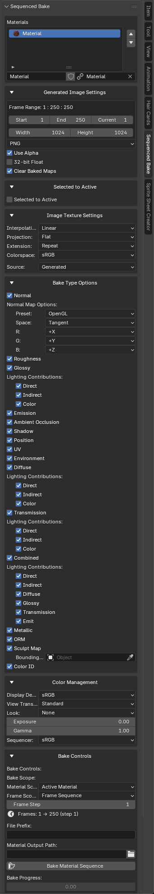
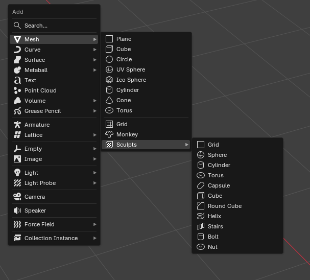
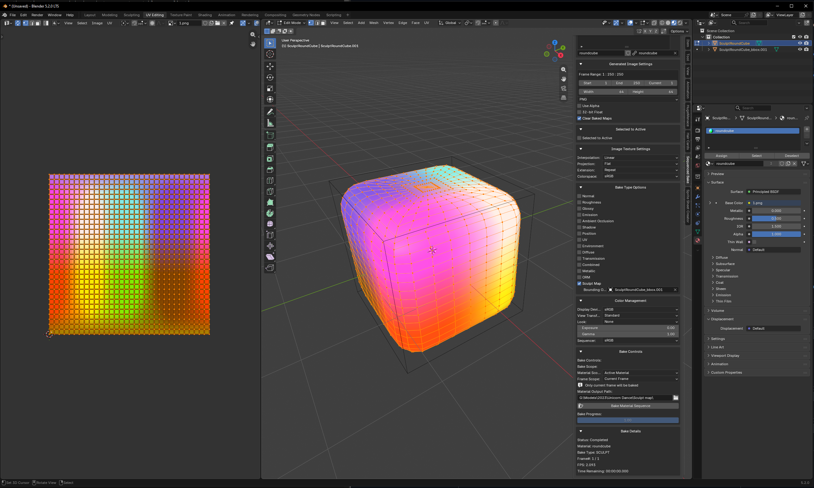
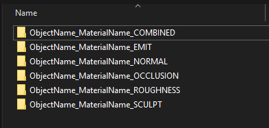
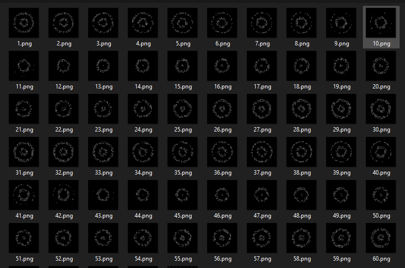
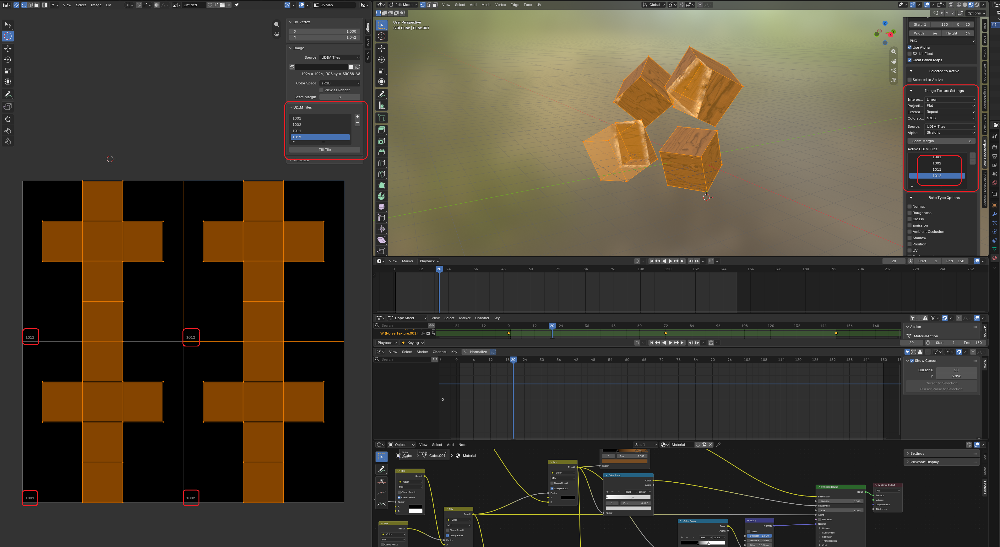
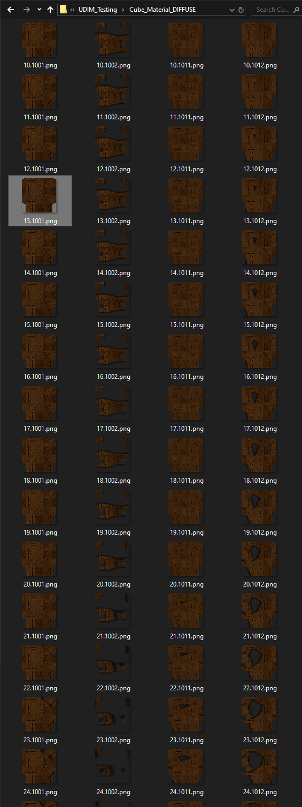
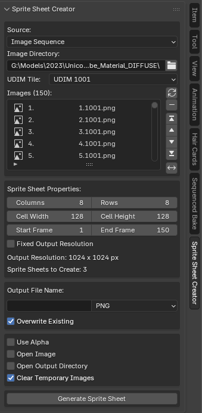
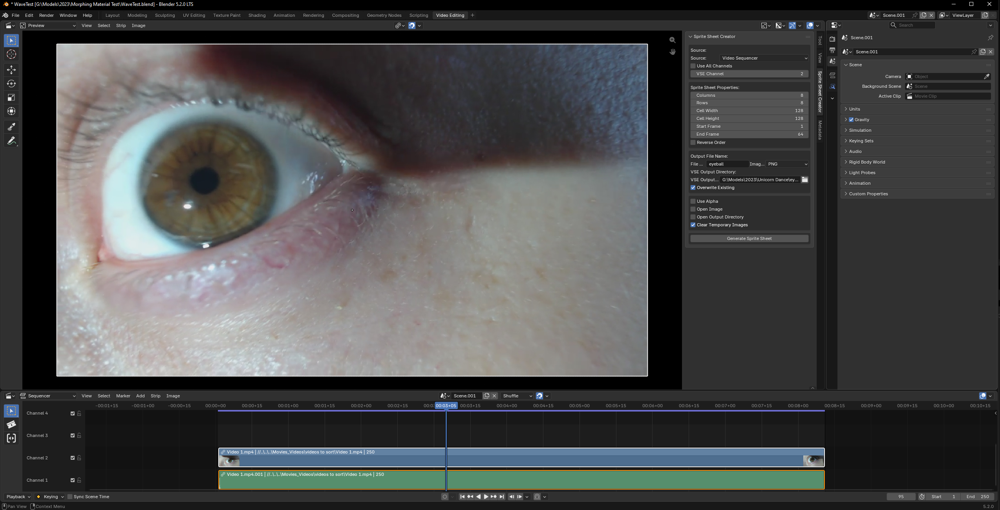
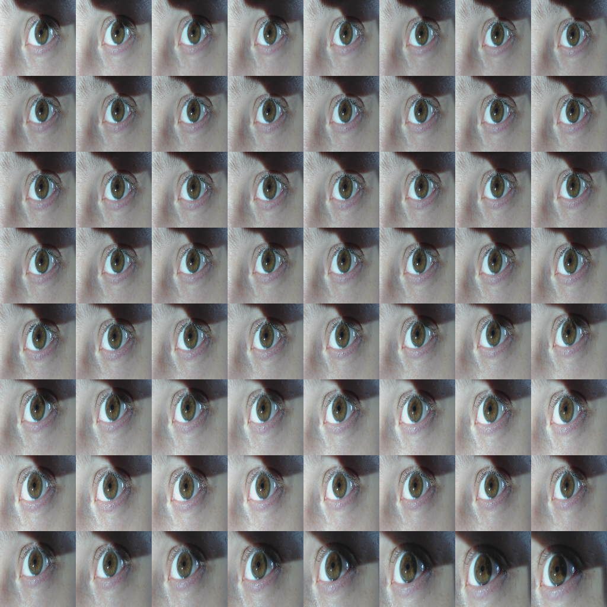

# Sequenced Bake

This extension is for baking animated materials and geometry into frame-by-frame texture sequences.

It provides a non-blocking, task-driven baking system that processes materials, bake types, and animation frames.

It is designed for:
- Animated and procedural materials
- PBR texture sequences
- Game asset workflows
- VFX and motion graphics
- Flipbook textures
- High-volume batch baking
- Second Life sculpt maps
- Color ID and texture atlas generation
- Procedural material development



---

# Core Features

### Sequenced Material Baking

- Bake an entire frame range automatically.
- Process one or multiple materials.
- Supports multiple bake types per frame.
- Supports animated shaders, drivers, and keyframed node values.
- Runs through a modal task queue to keep Blender responsive.
- Provides live progress, FPS, current task, and ETA.
- Supports customizable output filename prefixes.
- Automatically organizes generated texture sequences.

### Supported Bake Types

- Normal
- Roughness
- Glossy
- Diffuse
- Transmission
- Emission
- Ambient Occlusion
- Shadow
- Position
- UV
- Environment
- Combined
- Metallic
- ORM
- Sculpt
- Color ID

### Advanced Baking

- Selected-to-active baking
- Cage and ray-distance controls
- Custom Metallic baking
- ORM packed output:
  - Red = AO
  - Green = Roughness
  - Blue = Metallic
- Color ID baking with automatic color assignment for disconnected mesh islands
- Object-wide Color ID generation
- Configurable image resolution and formats
- 8-bit and 32-bit image support
- Color-management controls
- Automatic bake-target setup
- Custom output filename prefixes
- Optional cleanup of generated images

---

# Procedural Node Group Library

Sequenced Bake includes a collection of procedural Shader Editor node groups designed to accelerate material creation and procedural workflows.

Available node groups include:

- CrossWalk Decal
- Crack Decal
- Stain Decal
- Water Material
- Concrete Material
- Curvature Map
- Magma Material

### Node Group Features

- Accessible through the Shader Editor Add menu.
- Automatically creates node groups when needed.
- Organized under the Sequenced Bake node-group library.
- Designed for reusable procedural material workflows.
- Includes specialized material and surface-detail generation tools.

---

# Sculpt Map

The Sculpt Map system generates **object-space position maps** from mesh geometry and UVs.





[](https://www.youtube.com/watch?v=tJhFkORsI-U)

The system is designed for **Second Life sculpt maps** and supports animated geometry with stable frame-to-frame normalization.

### Sculpt Mesh Generator

A built-in **Add Sculpt Mesh** tool provides parametric meshes for sculpt-map creation, including:

- Grid
- Sphere
- Cylinder
- Torus
- Capsule
- Cube
- Round Cube
- Helix
- Stairs
- Bolt
- Nut

Sculpt map images must be (`4 times`) the size of the objects subdivisions.

Example: 
- A 16x16 plane must have a 64x64 sculpt map image to retain sharp edges.

Generated sculpt meshes include automatic UV mapping and a **Bounding Object** for consistent normalization.

### Sculpt Map Features

- Uses evaluated mesh geometry.
- Supports modifiers, shape keys, and animation.
- Rasterizes geometry through UV space.
- Uses barycentric interpolation for position sampling.
- Encodes X/Y/Z position into RGB.
- Supports resolutions up to **128×128** for sculpt-map workflows.
- Supports non-square resolutions.
- Includes edge filling to reduce filtering and seam artifacts.
- Stable normalization helps prevent animation frames from shifting or scaling.

---

# User Interface

Sequenced Bake is available through:

**3D View → Sidebar → Sequenced Bake**

The interface provides access to:

- Materials
- Frame ranges
- Image settings
- Bake types
- Color management
- Filename prefixes
- Bake controls
- Progress and diagnostics

A **Sequenced Bake Node** is also available in the Shader Editor for node-based workflows.

---

# Basic Workflow

1. Select an object with a material.
2. Set the render engine to **Cycles**.
3. Open the **Sequenced Bake** panel or node.
4. Choose the frame range and bake types.
5. Set the output location and image settings.
6. Configure optional filename prefixes.
7. Click **Bake Material Sequence**.

The add-on processes the sequence and saves the resulting textures by material and bake type.

---

# Output

Baked sequences are organized automatically:

```text
<output_path>/
└── <Object><Material><BakeType>/
    ├── 1.png
    ├── 2.png
    └── 3.png
```

Custom filename prefixes can be used to identify and organize generated sequences.





UDIM Tile workflows are also supported:





---

# Sprite Sheet Creator

**Sprite Sheet Creator** is the companion module for converting image sequences into sprite sheets and flipbook atlases.

**Bake → Image Sequence → Sprite Sheet**

It supports multiple image sources:

- Image directories
- Blender's Video Sequence Editor (VSE)
- Compositor output



### Image Sequence Management

- Automatic directory scanning.
- Automatic image sequence detection.
- Natural filename sorting.
- Manual image selection and list management.
- Add and remove individual images.
- Manually reorder images.
- Move images to the beginning or end of the sequence.
- Reverse image ordering.
- Refresh directory contents.
- Automatic UDIM tile detection and grouping.
- Individual image sequence management for each detected UDIM tile.

### Sprite Sheet Generation

- Configurable columns and rows.
- Automatic frame placement.
- Frame rescaling to cell size.
- Configurable cell dimensions.
- Fixed-resolution output.
- Automatic calculation of available sprite sheet cells.
- Automatic splitting of excess frames across multiple sprite sheets.
- Separate sprite sheet generation for individual UDIM tiles.
- Configurable output dimensions.
- Multiple output formats.
- Custom output filenames.
- Flexible output paths.
- Alpha channel support.
- Automatic naming and output organization.
- NumPy-backed image processing.

### Fixed-Resolution Output

Sprite Sheet Creator supports both traditional grid-based layouts and fixed-resolution sprite sheets.

When fixed-resolution output is enabled, the system calculates how many frames fit within the specified dimensions and automatically distributes additional frames across multiple sprite sheets.

For example:

```text
Output Resolution: 1024 x 1024
Cell Resolution:   128 x 128
Columns:           8
Rows:              8
Frames Per Sheet:  64
```

This allows large image sequences to be converted into multiple consistently sized sprite sheets without manually dividing the source images.

### UDIM Sprite Sheet Support

Image sequences containing UDIM identifiers are automatically detected and grouped by tile number.

Each UDIM group can be processed independently, generating separate sprite sheets for each detected tile.

### VSE Support

Sprite Sheet Creator can render frames from the Blender VSE and assemble them into sprite sheets.





---

# Typical Pipeline

Sequenced Bake and Sprite Sheet Creator can be used together as a complete material-animation pipeline:

```text
Animated Material
       ↓
Sequenced Bake
       ↓
Image Sequence
       ↓
Sprite Sheet Creator
       ↓
Flipbook / Sprite Atlas
       ↓
Real-Time Playback
```

This allows procedural and shader-driven animation to be converted into conventional texture sequences for use in real-time and downstream asset pipelines.

---

# Use Cases

### Game Development

- Animated PBR textures
- Flipbook materials
- Particle effects
- Pre-baked shader effects
- Engine-ready texture sequences
- Color ID texture generation
- Sprite sheet and atlas creation

### VFX & Motion Graphics

- Dissolves
- Energy effects
- Scans
- Animated masks
- Procedural effects
- Animated material caching

### Procedural Material Development

- Concrete surface materials
- Curvature-based effects
- Magma and lava materials
- Water materials
- Procedural decals
- Reusable Shader Editor node groups

### Procedural Material Caching

Bake time-dependent materials into image sequences for deterministic playback and reduced runtime shader evaluation.

### Second Life

- Sculpt map generation
- Animated sculpt workflows
- Texture sequences
- Flipbook-style material animation

---

# Requirements

- **Blender 5.2**
- **Cycles** render engine

---

# Community & Support

**Discord:** https://discord.gg/uZw54mGKZH